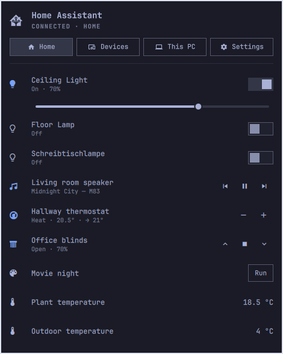
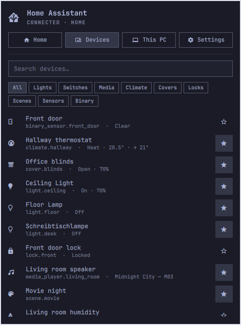
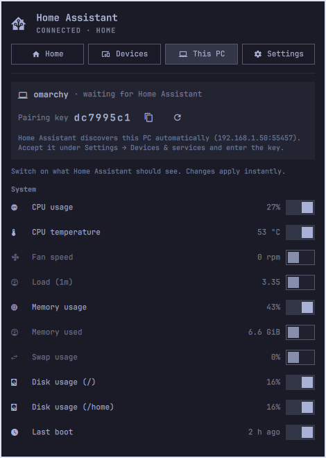
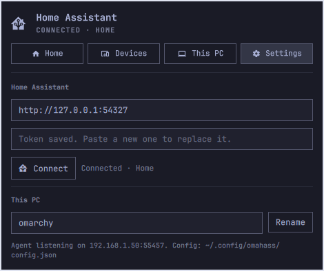

# omahass

Home Assistant ⇄ Omarchy, both directions, in one small daemon. It's HASS.Agent for Linux, plus a bar panel.

- **This PC in Home Assistant:** your machine shows up as a device with sensors, buttons, switches, sliders, a media player and a notification target. There's no MQTT: Home Assistant connects straight to the daemon.
- **Home Assistant in the bar:** favorites with inline controls, a device picker, and settings, all in one Omarchy panel.

| Home | Devices | This PC | Settings |
|:---:|:---:|:---:|:---:|
|  |  |  |  |

## How it fits together

```
 Omarchy bar ── omahassd attach ──unix socket──┐
 (QML plugin)      (stdin/stdout relay)        │
                                         ┌─────┴──────┐  WebSocket (client)
                                         │  omahassd  │ ───────────────────▶ Home Assistant
                                         │  (Go, ~20MB)│ ◀─────────────────── /api/websocket
                                         └─────┬──────┘  WebSocket (server, :47811)
                                               │  ◀──── custom_components/omahass
                                         mDNS _omahass._tcp (via avahi)
```

| Part | Where | What it does |
|---|---|---|
| `daemon/` | Go → `build/omahassd` | Sensors, commands, MPRIS, Hyprland events; HA client for the bar; agent server for HA; mDNS |
| `plugin/omahass/` | Omarchy shell plugin (QML) | Bar icon and panel: Home / Devices / This PC / Settings |
| `custom_components/omahass/` | Home Assistant integration (HACS) | Zeroconf discovery, pairing, entities, notify service |

## What Home Assistant gets

Every entity can be switched on or off in the bar under **This PC**, and changes apply instantly. The defaults are marked ✓.

| Group | Entities |
|---|---|
| System | CPU usage ✓, CPU temperature ✓, fan speed, load, memory usage ✓, memory used, swap, disk usage `/` ✓ and `/home` ✓, last boot ✓, kernel, OS |
| Power | battery ✓, charging ✓, power draw, plugged in ✓ |
| Network | download/upload speed, IP address ✓, Wi-Fi network |
| Privacy | webcam in use ✓, microphone in use ✓ |
| Desktop | active window ✓, active app ✓, workspace, displays on/off switch ✓, screen brightness slider ✓, notifications ✓ |
| Audio | volume slider ✓, mute ✓, mic mute, **media player** ✓ for whatever MPRIS player is active (Spotify, browser, mpv…) with artwork, seek and shuffle |
| Commands | lock ✓, screen off ✓, sleep ✓, hibernate, restart, shut down, log out |
| Custom commands | any shell command you add in the panel becomes a button ✓ |

The dangerous buttons (restart, shut down, log out, hibernate) start switched off.

### Notifications with buttons

```yaml
action: omahass.send_actionable
target:
  entity_id: notify.omarchy_notifications
data:
  title: Doorbell
  message: Someone's at the door
  actions:
    - action: open_door
      title: Open
    - action: ignore
      title: Ignore
  tag: doorbell
```

Pressing a button fires the `omahass_notification_action` event with `action`, `tag`, `device_id` and `device_name`. Plain `notify.send_message` works too.

## Install

### 1. Daemon and bar plugin (on the PC)

You need Go (`pacman -S go` or `mise use go`).

```bash
git clone https://github.com/jkramer5103/omahass.git
cd omahass
make install
```

This command:
- copies `omahassd` to `~/.local/bin`
- installs and starts the `omahassd` systemd user service (capped at 128 MB)
- symlinks the plugin into `~/.config/omarchy/plugins/omahass` and enables it in the bar

Omarchy's firewall (ufw) blocks incoming connections by default. Open the agent port, plus mDNS so Home Assistant can discover the PC:

```bash
sudo ufw allow 47811/tcp
sudo ufw allow 5353/udp
```

Then open the panel → **Settings**, and paste your HA URL and a long-lived access token (HA → your profile → Security).

### 2. Integration (Home Assistant)

- **HACS:** ⋮ → Custom repositories → add `https://github.com/jkramer5103/omahass` as *Integration* → install *Omarchy PC*. Restart HA.
- **Manually:** copy `custom_components/omahass` to `/config/custom_components/` (Samba or SSH add-on), then restart HA.

HA discovers the PC through zeroconf. Go to *Settings → Devices & services*, find the discovered **Omarchy PC**, and enter the pairing key. The key is shown in the panel under **This PC**, or by running `omahassd key`. To add the PC by hand, use host = PC IP and port = 47811.

## Configuration

Everything is in `~/.config/omahass/config.json` and normally edited from the panel:
- HA URL and token
- favorites (in order)
- device name, agent port, pairing key
- the expose map
- custom commands
- `poll_seconds`, the fast sensor interval (default 5)

## Development

```bash
make build      # Go build, memory-capped (needs Go: `mise use go` or pacman go)
make test-go    # daemon unit tests with -race (fake HA, agent protocol)
make test-ha    # the integration inside a real Home Assistant core, against a real daemon
make preview    # render the panel off-screen against tests/fake_ha.py → docs/screenshots
```

`tests/fake_ha.py` is a tiny Home Assistant (WebSocket API, token `demo`) with demo devices, handy for working on the panel without touching your real instance.

### Panel protocol (NDJSON over `$XDG_RUNTIME_DIR/omahass.sock`)

The panel sends:
- `call`
- `list`
- `favorite` / `move_favorite`
- `set_ha`
- `expose`
- `run_pc`
- `set_device`
- `regen_key`
- `add_command` / `remove_command`
- `set_poll`
- `refresh`

The daemon answers with:
- `hello`
- `status`
- `favorites`
- `state`
- `pc` / `pc_states`
- `config`
- `list`
- `result`

`omahassd attach` adds `daemon {running}` while the daemon is down.

### Agent protocol (WebSocket `ws://pc:47811/ws`)

1. HA sends `hello {key}`.
2. The daemon replies `welcome {device, entities, states}`, or `error invalid_key`.
3. After that, the daemon pushes:
   - `states` (changed values only)
   - `entities` (schema changed, so HA reloads the entry)
   - `event` (`notification_action`)
4. HA sends `command {id, key, value}`, and the daemon answers `result {id, ok, error}`.

Artwork is served at `/art?key=…`.
